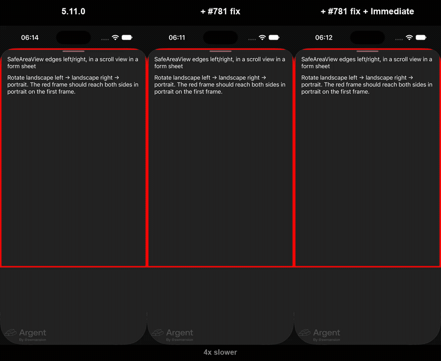

# react-native-safe-area-context: stale insets in a form sheet after rotation (iOS, Fabric)

Repro for [appandflow/react-native-safe-area-context#781](https://github.com/appandflow/react-native-safe-area-context/issues/781) and [#802](https://github.com/appandflow/react-native-safe-area-context/issues/802).

Expo SDK 58, React Native 0.88.1, react-native-screens 4.30.1, react-native-safe-area-context 5.11.0, iOS 27 simulator (iPhone 18 Pro).

`src/app/sheet.tsx`: a `SafeAreaView edges={['left', 'right']}` in a `ScrollView` in an Expo Router `formSheet`. `src/app/_layout.tsx` keeps the UI thread and the JS thread busy, as in an app with a 3D view.

## Steps

1. `npm install && npx expo run:ios`
2. Tap **Open sheet**.
3. Rotate landscape left → landscape right → portrait.

The red frame should clear the notch in landscape and reach both sides in portrait.

## Result

([MP4](media/before-after-4x-slow.mp4))

| Build | Result |
|---|---|
| 5.11.0 | In portrait, the frame keeps the landscape inset (62 pt) until the next React commit. The sheet is outside the provider's view tree, so the view is its own provider, and nothing tells it that its insets changed (#781). |
| + `safeAreaInsetsDidChange` | Insets follow, but in landscape the frame stays under the notch for about 8 frames: the async state update waits for the busy threads (#802). |
| + `unstable_Immediate` | Correct on every frame. |

## Fix

`fix.patch` has both changes: `patch -p1 < fix.patch`, then `npx expo run:ios`.
